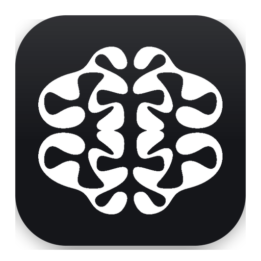
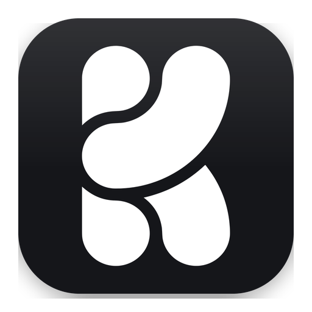
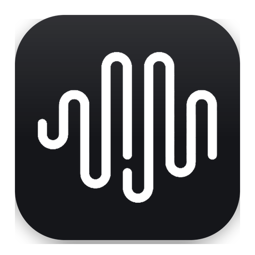
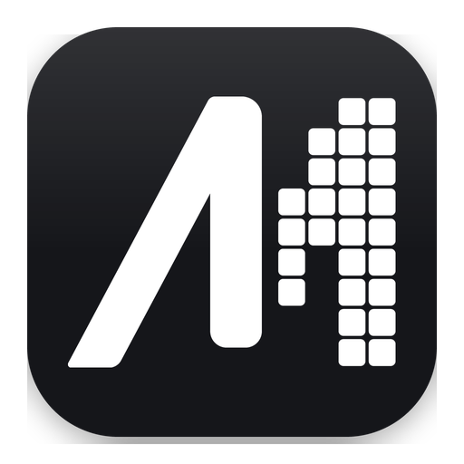
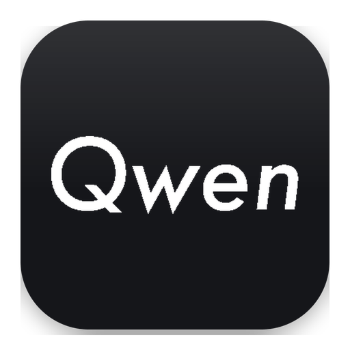
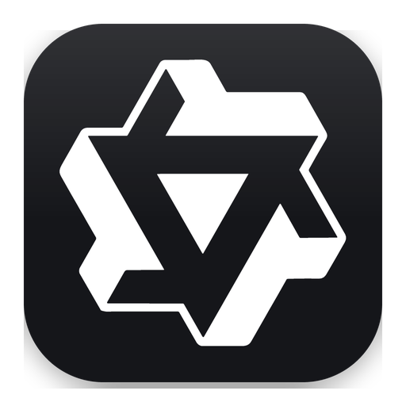

<h1>
  
  
</h1>

> Turn any ComfyUI workflow into a model for Unplatform AI. Save it, add one URL in the app, generate.

## Quick start

1. Install the pack from ComfyUI Manager, search "Unplatform AI Provider". See [getting started](docs/user/getting-started.md).
2. Open a workflow from `workflows/` and save it in ComfyUI.
3. Add the ComfyUI URL in Unplatform AI. See [getting started](docs/user/getting-started.md).

## Workflows

<table>
<thead>
<tr>
<th width="90"></th>
<th align="left">Model</th>
<th align="left">Kind</th>
<th align="left">Modes</th>
<th align="left">VRAM (full speed)</th>
<th align="left">Docs</th>
</tr>
</thead>
<tbody>
<tr>
<td width="90" align="center"></td>
<td>FLUX.2 Klein</td>
<td>Image</td>
<td>Text-to-image, multi-image edit (4 refs)</td>
<td>16 GB</td>
<td><a href="workflows/flux-2-klein-upai.json">JSON</a> <a href="workflows/flux-2-klein-readme.md">Guide</a> <a href="workflows/flux-2-klein-skill.md">Skill</a></td>
</tr>
<tr>
<td width="90" align="center"></td>
<td>Ideogram 4</td>
<td>Image</td>
<td>Text-to-image (JSON prompt)</td>
<td>24 GB</td>
<td><a href="workflows/ideogram-4-upai.json">JSON</a> <a href="workflows/ideogram-4-readme.md">Guide</a> <a href="workflows/ideogram-4-skill.md">Skill</a></td>
</tr>
<tr>
<td width="90" align="center"></td>
<td>Krea 2</td>
<td>Image</td>
<td>Text-to-image, style reference (2 refs)</td>
<td>24 GB</td>
<td><a href="workflows/krea-2-upai.json">JSON</a> <a href="workflows/krea-2-readme.md">Guide</a> <a href="workflows/krea-2-skill.md">Skill</a></td>
</tr>
<tr>
<td width="90" align="center"></td>
<td>LTX 2.5</td>
<td>Video</td>
<td>Text-to-video, image-to-video, first-last-frame</td>
<td>32 GB</td>
<td><a href="workflows/ltx-2-5-upai.json">JSON</a> <a href="workflows/ltx-2-5-readme.md">Guide</a> <a href="workflows/ltx-2-5-skill.md">Skill</a></td>
</tr>
<tr>
<td width="90" align="center"></td>
<td>MiniMax H3</td>
<td>Video</td>
<td>Text-to-video, image-to-video, first-last-frame, reference-to-video</td>
<td>32 GB</td>
<td><a href="workflows/minimax-h3-upai.json">JSON</a> <a href="workflows/minimax-h3-readme.md">Guide</a> <a href="workflows/minimax-h3-skill.md">Skill</a></td>
</tr>
<tr>
<td width="90" align="center"></td>
<td>MOSS Image</td>
<td>Image</td>
<td>Text-to-image, img2img</td>
<td>12 GB</td>
<td><a href="workflows/moss-image-upai.json">JSON</a> <a href="workflows/moss-image-readme.md">Guide</a> <a href="workflows/moss-image-skill.md">Skill</a></td>
</tr>
<tr>
<td width="90" align="center"></td>
<td>Qwen 2.1</td>
<td>Image</td>
<td>Text-to-image, reference edit (10 refs), head swap, body swap</td>
<td>12 GB</td>
<td><a href="workflows/qwen-2-1-upai.json">JSON</a> <a href="workflows/qwen-2-1-readme.md">Guide</a> <a href="workflows/qwen-2-1-skill.md">Skill</a></td>
</tr>
<tr>
<td width="90" align="center"></td>
<td>Wan 2.2</td>
<td>Video</td>
<td>Text-to-video, image-to-video, first-last-frame</td>
<td>24 GB</td>
<td><a href="workflows/wan-2-2-upai.json">JSON</a> <a href="workflows/wan-2-2-readme.md">Guide</a> <a href="workflows/wan-2-2-skill.md">Skill</a></td>
</tr>
<tr>
<td width="90" align="center"></td>
<td>Z-Image</td>
<td>Image</td>
<td>Text-to-image, img2img</td>
<td>12 GB</td>
<td><a href="workflows/z-image-upai.json">JSON</a> <a href="workflows/z-image-readme.md">Guide</a> <a href="workflows/z-image-skill.md">Skill</a></td>
</tr>
</tbody>
</table>

Smaller cards run with offload to system RAM, slower. RAM must hold the models.

9 workflows, 12 models (8 image, 4 video). Some workflows hold several models.

## Docs

- [Getting started](docs/user/getting-started.md)
- [Node reference](docs/user/nodes/README.md)
- [Build a workflow](docs/user/build-a-workflow.md)
- [Network](docs/user/network.md)
- [Memory](docs/user/memory.md)
- [Troubleshooting](docs/user/troubleshooting.md)
- [FAQ](docs/user/faq.md)

## For developers

- [Architecture](docs/ARCHITECTURE.md)
- [Development](docs/DEVELOPMENT.md)
- [Protocol spec](protocol/spec.md)

## License

GPL-3.0 for the pack. `protocol/` is MIT.

Not affiliated with ComfyUI or any model provider.
