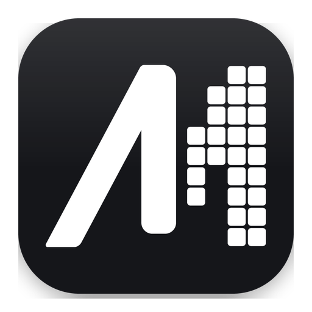
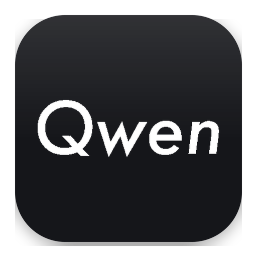
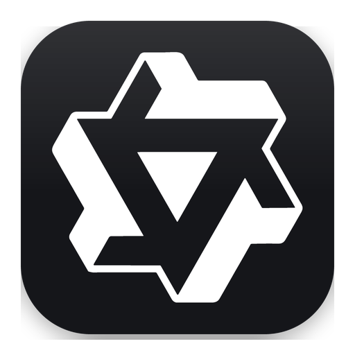
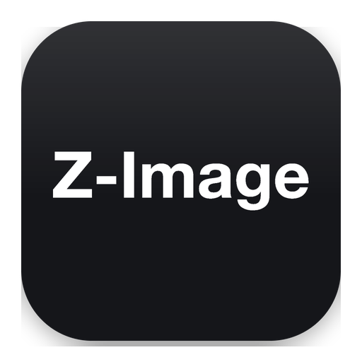

# Workflows

<table>
<thead>
<tr>
<th width="90"></th>
<th align="left">Model</th>
<th align="left">Kind</th>
<th align="left">Modes</th>
<th align="left">VRAM (full speed)</th>
<th align="left">Docs</th>
</tr>
</thead>
<tbody>
<tr>
<td width="90" align="center"></td>
<td>FLUX.2 Klein</td>
<td>Image</td>
<td>Text-to-image / image-to-image with up to 4 references.</td>
<td>16 GB</td>
<td><a href="flux-2-klein-upai.json">JSON</a> <a href="flux-2-klein-readme.md">Guide</a> <a href="flux-2-klein-skill.md">Skill</a></td>
</tr>
<tr>
<td width="90" align="center"></td>
<td>Ideogram 4</td>
<td>Image</td>
<td>Text-to-image.</td>
<td>24 GB</td>
<td><a href="ideogram-4-upai.json">JSON</a> <a href="ideogram-4-readme.md">Guide</a> <a href="ideogram-4-skill.md">Skill</a></td>
</tr>
<tr>
<td width="90" align="center"></td>
<td>Krea 2</td>
<td>Image</td>
<td>Text-to-image / image-to-image with up to 2 references.</td>
<td>24 GB</td>
<td><a href="krea-2-upai.json">JSON</a> <a href="krea-2-readme.md">Guide</a> <a href="krea-2-skill.md">Skill</a></td>
</tr>
<tr>
<td width="90" align="center"></td>
<td>LTX 2.5 <small>LTX 2.5 Extend LTX 2.5 Upscale</small></td>
<td>Video</td>
<td>Text-to-video / image-to-video / first-last-frame video with up to 2 frame references. Generates audio. Video-to-video extend by up to 10 seconds with 1 video reference. Audio continues. Video-to-video upscale to 720p or 1080p with 1 video reference. Audio is kept.</td>
<td>32 GB</td>
<td><a href="ltx-2-5-upai.json">JSON</a> <a href="ltx-2-5-readme.md">Guide</a> <a href="ltx-2-5-skill.md">Skill</a></td>
</tr>
<tr>
<td width="90" align="center"></td>
<td>MiniMax H3 <small>MiniMax H3 Fast MiniMax H3 Extend MiniMax H3 Image MiniMax H3 Image Fast</small></td>
<td>Video, image</td>
<td>Text-to-video / image-to-video with up to 9 image, 3 video and 3 audio references. Fast text-to-video / image-to-video with up to 9 image, 3 video and 3 audio references. Video-to-video extend by up to 15 seconds with 1 video reference. Audio continues. Text-to-image / image-to-image with up to 16 references. Fast 2-step text-to-image / image-to-image with up to 16 references.</td>
<td>32 GB</td>
<td><a href="minimax-h3-upai.json">JSON</a> <a href="minimax-h3-readme.md">Guide</a> <a href="minimax-h3-skill.md">Skill</a></td>
</tr>
<tr>
<td width="90" align="center"></td>
<td>MOSS Image <small>MOSS Pose</small></td>
<td>Image</td>
<td>Text-to-image / image-to-image. Image-to-image with 1 pose reference.</td>
<td>12 GB</td>
<td><a href="moss-image-upai.json">JSON</a> <a href="moss-image-readme.md">Guide</a> <a href="moss-image-skill.md">Skill</a></td>
</tr>
<tr>
<td width="90" align="center"></td>
<td>Qwen 2.1 <small>Qwen 2.1 Head Swap Qwen 2.1 Body Swap Qwen 2.1 Outpaint</small></td>
<td>Image</td>
<td>Text-to-image / image-to-image with up to 10 references. Image-to-image with 2 references. No prompt. Image-to-image with 2 references. No prompt. Image-to-image outpaint to the selected resolution and aspect. No prompt.</td>
<td>12 GB</td>
<td><a href="qwen-2-1-upai.json">JSON</a> <a href="qwen-2-1-readme.md">Guide</a> <a href="qwen-2-1-skill.md">Skill</a></td>
</tr>
<tr>
<td width="90" align="center"></td>
<td>Wan 2.2</td>
<td>Video</td>
<td>Text-to-video / image-to-video / first-last-frame video. Silent.</td>
<td>24 GB</td>
<td><a href="wan-2-2-upai.json">JSON</a> <a href="wan-2-2-readme.md">Guide</a> <a href="wan-2-2-skill.md">Skill</a></td>
</tr>
<tr>
<td width="90" align="center"></td>
<td>Z-Image</td>
<td>Image</td>
<td>Text-to-image / image-to-image.</td>
<td>12 GB</td>
<td><a href="z-image-upai.json">JSON</a> <a href="z-image-readme.md">Guide</a> <a href="z-image-skill.md">Skill</a></td>
</tr>
</tbody>
</table>

MiniMax H3 Image license excludes use in the US, EU, UK and South Korea. Check the license before use.

Smaller cards run with offload to system RAM, slower. RAM must hold the models.
