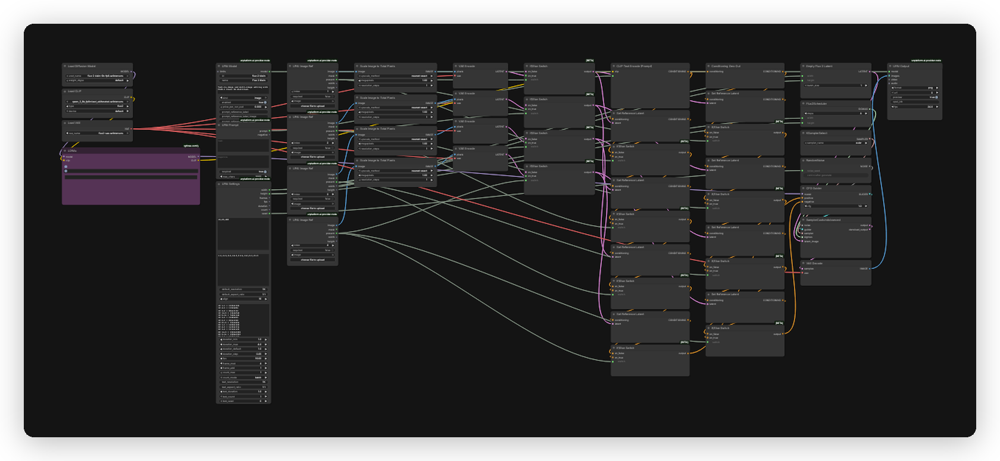

# FLUX.2 Klein UPAI flow

## What it does

Text-to-image and multi-image editing with FLUX.2 Klein 9B distilled at 4 steps. The flow accepts up to 4 reference images. References condition the model but do not change the canvas size, which follows the UPAI Settings pick.

## Modes

| Mode | Input | Output |
|---|---|---|
| Text-to-image | prompt | one image at the settings size |
| Multi-image edit | prompt and 1 to 4 reference images | one image at the settings size |

## Quick start

1. Install ComfyUI 0.43.0 or newer and the `unplatform-ai-provider-node` pack.
2. Open `flux-2-klein-upai.json` in ComfyUI.
3. ComfyUI reads the download and install links from the workflow. Open the right-side Error tab and click Install for missing packs and Download for missing models. No copy-paste from this readme.
4. The default flow uses no GGUF. Optional GGUF files are manual. Use the chain icon next to the missing file or the URLs below.
5. Restart ComfyUI after installing a pack. Save the workflow once so UPAI exports it.
6. Check `GET /upai/api/v1/health`.

## Memory

Full speed means the largest phase fits in VRAM. Smaller cards run with offload to system RAM, slower. System RAM must hold the model files.

| Phase | Weights | Headroom | Total |
|---|---:|---:|---:|
| Text encode | 7.63 GiB | 0.50 GiB | 8.13 GiB |
| Sampling, 1K | 8.79 GiB | 2.00 GiB | 10.79 GiB |
| Decode | 0.31 GiB | 0.00 GiB | 0.31 GiB |

Full-speed VRAM: 16 GB card. System RAM: 24 GB.

| File | Size | Note |
|---|---:|---|
| `flux-2-klein-9b-fp8.safetensors` | 8.79 GiB | estimate |
| `qwen_3_8b_fp8mixed_abliterated.safetensors` | 7.63 GiB | estimate |
| `flux2-vae.safetensors` | 0.31 GiB | estimate |
| `lenovo_flux_klein9b.safetensors` | 0.16 GiB | estimate, not resident |

LoRAs patch the model and do not stay resident.

Smaller files:

| Quant | File | Sampling total | Full-speed card |
|---|---:|---:|---:|
| Q8 | 9.54 GiB | 11.54 GiB | 16 GB |
| Q5 | 6.46 GiB | 8.46 GiB | 12 GB |
| Q4 | 5.43 GiB | 7.43 GiB | 12 GB |

The text encoder at 7.63 GiB sets an 8.13 GiB text encode phase. Q6 is not in Aitrepreneur/FLX. Install `ComfyUI-GGUF` and replace `UNETLoader` (`unet_name`) with `UnetLoaderGGUF` (`unet_name`). Lower quantizations cost some quality. Q5_K_S is the usual tradeoff.

Low VRAM:

- Set `UNETLoader` or `UnetLoaderGGUF` `unet_name` to the Q5 or Q4 file.
- In UPAI Settings, set `resolutions` to `1K` (node id 3).

## Models

| File | Folder | Note |
|---|---|---|
| `flux-2-klein-9b-fp8.safetensors` | `models/diffusion_models` | auto |
| `qwen_3_8b_fp8mixed_abliterated.safetensors` | `models/text_encoders` | auto |
| `flux2-vae.safetensors` | `models/vae` | auto |
| `lenovo_flux_klein9b.safetensors` | `models/loras` | auto |
| `flux-2-klein-9b-Q4_K_S.gguf` | `models/unet` | manual GGUF, optional |
| `flux-2-klein-9b-Q5_K_S.gguf` | `models/unet` | manual GGUF, optional |
| `flux-2-klein-9b-Q8_0.gguf` | `models/unet` | manual GGUF, optional |

Manual GGUF URLs:

- `flux-2-klein-9b-Q4_K_S.gguf`: https://huggingface.co/Aitrepreneur/FLX/resolve/main/flux-2-klein-9b-Q4_K_S.gguf?download=true
- `flux-2-klein-9b-Q5_K_S.gguf`: https://huggingface.co/Aitrepreneur/FLX/resolve/main/flux-2-klein-9b-Q5_K_S.gguf?download=true
- `flux-2-klein-9b-Q8_0.gguf`: https://huggingface.co/Aitrepreneur/FLX/resolve/main/flux-2-klein-9b-Q8_0.gguf?download=true

Licenses:

- `flux-2-klein-9b-fp8.safetensors`: License: FLUX Non-Commercial License. Source: https://huggingface.co/black-forest-labs/FLUX.2-klein-9B
- `qwen_3_8b_fp8mixed_abliterated.safetensors`: License: Apache-2.0. Source: https://huggingface.co/edicamargo/qwen_3_8b_fp8mixed_abliterated
- `flux2-vae.safetensors`: License: FLUX Non-Commercial License. Source: https://huggingface.co/black-forest-labs/FLUX.2-klein-9B
- `lenovo_flux_klein9b.safetensors`: License: MIT. Source: https://huggingface.co/Danrisi/Lenovo_FluxKlein9b_base
- `flux-2-klein-9b-Q4_K_S.gguf`, `flux-2-klein-9b-Q5_K_S.gguf`, `flux-2-klein-9b-Q8_0.gguf`: License: FLUX Non-Commercial License. Source: https://huggingface.co/black-forest-labs/FLUX.2-klein-9B

The default flow is safetensors and GGUF-free. To use GGUF, install `ComfyUI-GGUF`, put one file in `models/unet`, and replace `UNETLoader` with `UnetLoaderGGUF`.

## Settings

| Control | Value |
|---|---|
| Steps | 4 |
| CFG | 1.0 |
| Sampler | `euler` |
| Scheduler | `Flux2Scheduler` |
| Pixel grid | 16 |
| Prompt budget | 512 tokens, UPAI Prompt caps at 2000 characters |
| Negative prompt | none |

The LORAs node enables `lenovo_flux_klein9b` at 0.6. Add the trigger `l3n0v0` at the start of the prompt. Adjust strength from 0.4 to 0.8 if needed. The negative branch uses `ConditioningZeroOut`, not a semantic negative prompt.

Sizes run at 1K, 2K and 4MP across 8 aspect ratios (1:1, 4:3, 3:4, 16:9, 9:16, 3:2, 2:3, 21:9). Every size is a multiple of 16. The maximum side is 2048 and the maximum area is 4 MP. The app shows exact pixels.

## Troubleshooting

- UPAI nodes missing: install `unplatform-ai-provider-node` and restart ComfyUI.
- LORAs node missing: install `rgthree-comfy` and restart.
- LoRA row red: `lenovo_flux_klein9b` is missing from `models/loras`.
- GGUF loader missing: install `ComfyUI-GGUF` and restart.
- Loader red: the model file is in the wrong folder or missing.
- Out of memory: use 1K or 2K, or a smaller GGUF quantization.
- Health check: `curl http://127.0.0.1:8188/upai/api/v1/health`.
