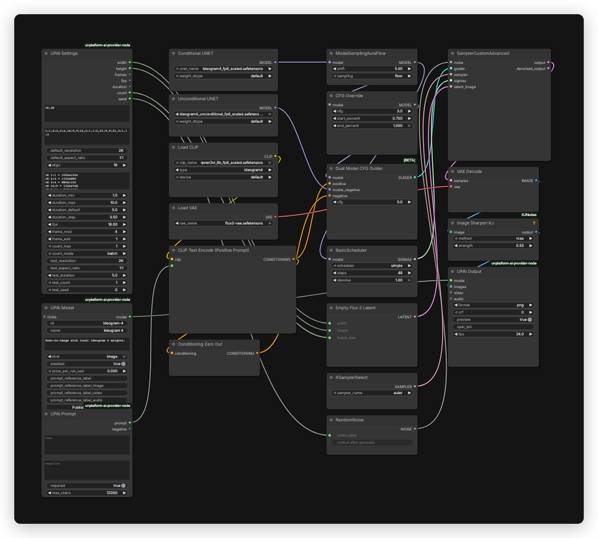

# Ideogram 4 UPAI flow

## What it does

Text-to-image with local Ideogram 4 dual-model weights at the 48-step quality preset. Ideogram 4 reads structured JSON prompts and renders dense in-image text well. The flow has no reference image input and does not include img2img.

## Modes

| Mode | Input | Output |
|---|---|---|
| Text-to-image | structured JSON prompt | one image at the settings size |

## Quick start

1. Install ComfyUI 0.43.0 or newer and the `unplatform-ai-provider-node` pack.
2. Open `ideogram-4-upai.json` in ComfyUI.
3. ComfyUI reads the download and install links from the workflow. Open the right-side Error tab and click Install for missing packs and Download for missing models. No copy-paste from this readme.
4. This flow uses no GGUF. All model files are auto-downloaded from the workflow.
5. Restart ComfyUI after installing a pack, then hard reload the tab. Save the workflow once so UPAI exports it.
6. Check `GET /upai/api/v1/health`.

## Memory

Full speed means the largest phase fits in VRAM. Smaller cards run with offload to system RAM, slower. System RAM must hold the model files.

| Phase | Weights | Headroom | Total |
|---|---:|---:|---:|
| Text encode | 9.86 GiB | 0.50 GiB | 10.36 GiB |
| Sampling, 2K, dual UNET | 17.29 GiB | 2.00 GiB | 19.29 GiB |
| Decode | 0.31 GiB | 0.00 GiB | 0.31 GiB |

Full-speed VRAM: 24 GB card. System RAM: 32 GB.

| File | Size | Note |
|---|---:|---|
| `ideogram4_fp8_scaled.safetensors` | 8.64 GiB | estimate |
| `ideogram4_unconditional_fp8_scaled.safetensors` | 8.64 GiB | estimate |
| `qwen3vl_8b_fp8_scaled.safetensors` | 9.86 GiB | estimate |
| `flux2-vae.safetensors` | 0.31 GiB | estimate |

Both UNETs load together in the sampling phase.

Low VRAM:

- In UPAI Settings, set `default_resolution` to `1K` (node id 1) and `resolutions` to `1K`.
- Full speed needs a 24 GB card. Both UNETs load together. Smaller cards offload to system RAM.

## Models

| File | Folder | Note |
|---|---|---|
| `ideogram4_fp8_scaled.safetensors` | `models/diffusion_models` | auto, conditional |
| `ideogram4_unconditional_fp8_scaled.safetensors` | `models/diffusion_models` | auto, unconditional |
| `qwen3vl_8b_fp8_scaled.safetensors` | `models/text_encoders` | auto |
| `flux2-vae.safetensors` | `models/vae` | auto |

No GGUF file is used. The flow uses no LoRAs and no reference images.

Licenses:

- `ideogram4_fp8_scaled.safetensors`: License: Ideogram Non-Commercial License. Source: https://huggingface.co/ideogram-ai/ideogram-4-fp8
- `ideogram4_unconditional_fp8_scaled.safetensors`: License: Ideogram Non-Commercial License. Source: https://huggingface.co/ideogram-ai/ideogram-4-fp8
- `qwen3vl_8b_fp8_scaled.safetensors`: License: Apache-2.0. Source: https://huggingface.co/Qwen/Qwen3-VL-8B-Instruct
- `flux2-vae.safetensors`: License: Ideogram Non-Commercial License. Source: https://huggingface.co/Comfy-Org/Ideogram-4

`ImageSharpenKJ` comes from `ComfyUI-KJNodes`. The rest is core Ideogram 4 support: `DualModelGuider`, `CFGOverride`, `EmptyFlux2LatentImage` and `ModelSamplingAuraFlow`. Update ComfyUI if any are missing.

## Settings

| Control | Value |
|---|---|
| Steps | 48 |
| Sampler | `euler` |
| Scheduler | `simple` |
| Denoise | 1.0 |
| ModelSamplingAuraFlow shift | 5.0 |
| CFGOverride | 3.0, start 0.7, end 1.0 |
| DualModelGuider CFG | 5.0 |
| Sharpen | `rcas`, 0.55 |
| Default size | 2K, 1:1 |
| Grid | 16 pixels |
| Prompt budget | 2048 tokens, UPAI Prompt caps at 12000 characters |

The conditional model feeds `ModelSamplingAuraFlow`, then `BasicScheduler` and `CFGOverride`. The unconditional model feeds `DualModelGuider.model_negative`. The negative conditioning is a zeroed copy of the positive, so the prompt negative output stays disconnected.

Sizes run at 1K and 2K across 11 aspect ratios (1:1, 4:3, 3:4, 16:9, 9:16, 2:1, 1:2, 21:9, 9:21, 3:1, 1:3). The default is 2K 1:1. Every size is a multiple of 16 and the longest side is 2048. The app shows exact pixels.

## Troubleshooting

- `ImageSharpenKJ` missing: install `ComfyUI-KJNodes`, restart ComfyUI and hard reload the tab.
- UPAI nodes missing: install `unplatform-ai-provider-node` and restart.
- UNET, CLIP or VAE loader red: the file is in the wrong folder or still downloading.
- `DualModelGuider` or `CFGOverride` missing: update ComfyUI for Ideogram 4 support.
- Prompt rejected: check JSON syntax, `bbox` order and range, palette size and the 2048 token cap.
- Out of memory at 2K: use 1K or lower the batch count.
- Health check: `curl http://127.0.0.1:8188/upai/api/v1/health`.
