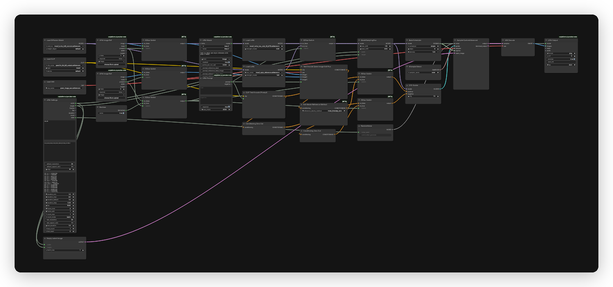

# Krea 2 UPAI flow

## What it does

Text-to-image and style reference with Krea 2 Turbo at 8 steps. With no reference the flow runs text-to-image with the turbo LoRA at 0.2. With one or two references it runs the style path with the style LoRA at 1.0 and no turbo LoRA. Output size follows the selected UPAI Settings size.

## Modes

| Mode | Input | Output |
|---|---|---|
| Text-to-image | prompt | one image at the settings size |
| Style reference | prompt and 1 or 2 reference images | one image at the settings size |

References influence color, light, texture and medium. They do not change the canvas size.

## Quick start

1. Install ComfyUI 0.43.0 or newer and the `unplatform-ai-provider-node` pack.
2. Open `krea-2-upai.json` in ComfyUI.
3. ComfyUI reads the download and install links from the workflow. Open the right-side Error tab and click Install for missing packs and Download for missing models. No copy-paste from this readme.
4. This flow uses no GGUF. All model files are auto-downloaded from the workflow.
5. Restart ComfyUI after installing a pack. Save the workflow once so UPAI exports it.
6. Check `GET /upai/api/v1/health`.

## Memory

Full speed means the largest phase fits in VRAM. Smaller cards run with offload to system RAM, slower. System RAM must hold the model files.

| Phase | Weights | Headroom | Total |
|---|---:|---:|---:|
| Text encode | 4.88 GiB | 0.50 GiB | 5.38 GiB |
| Sampling, 2K | 12.57 GiB | 2.00 GiB | 14.57 GiB |
| Decode | 0.24 GiB | 0.00 GiB | 0.24 GiB |

Full-speed VRAM: 24 GB card. System RAM: 24 GB.

| File | Size | Note |
|---|---:|---|
| `krea2_turbo_int8_convrot.safetensors` | 12.57 GiB | estimate |
| `qwen3vl_4b_fp8_scaled.safetensors` | 4.88 GiB | estimate |
| `qwen_image_vae.safetensors` | 0.24 GiB | estimate |
| `krea2_turbo_lora_rank_64_bf16.safetensors` | 0.44 GiB | estimate, not resident |
| `krea2_style_reference.safetensors` | 0.43 GiB | estimate, not resident |

LoRAs patch the model and do not stay resident.

Low VRAM:

- In UPAI Settings, set `default_resolution` to `1K` (node id 1).
- Start ComfyUI with `--reserve-vram 0.5` or `--reserve-vram 1`.

## Models

| File | Folder | Note |
|---|---|---|
| `krea2_turbo_int8_convrot.safetensors` | `models/diffusion_models` | auto |
| `qwen3vl_4b_fp8_scaled.safetensors` | `models/text_encoders` | auto |
| `qwen_image_vae.safetensors` | `models/vae` | auto |
| `krea2_turbo_lora_rank_64_bf16.safetensors` | `models/loras` | auto |
| `krea2_style_reference.safetensors` | `models/loras` | auto |

No GGUF file is used. Keep the exact file names, the loaders use them as defaults.

Licenses:

- `krea2_turbo_int8_convrot.safetensors`: License: Krea 2 Community License. Source: https://huggingface.co/krea/Krea-2-Turbo
- `qwen3vl_4b_fp8_scaled.safetensors`: License: Apache-2.0. Source: https://huggingface.co/Qwen/Qwen3-VL-4B-Instruct
- `qwen_image_vae.safetensors`: License: Apache-2.0. Source: https://huggingface.co/Qwen/Qwen-Image
- `krea2_turbo_lora_rank_64_bf16.safetensors`: License: Krea 2 Community License. Source: https://huggingface.co/Comfy-Org/Krea-2
- `krea2_style_reference.safetensors`: License: Krea 2 Community License. Source: https://huggingface.co/ostris/krea2_turbo_style_reference

## Settings

| Control | Value |
|---|---|
| Steps | 8 |
| CFG | 1.0 |
| Sampler | `euler` |
| Scheduler | `simple` |
| ModelSamplingFlux max shift | 1.15 |
| ModelSamplingFlux base shift | 0.5 |
| Denoise | 1.0 |
| Text-to-image LoRA | `krea2_turbo_lora_rank_64_bf16` at 0.2 |
| Style reference LoRA | `krea2_style_reference` at 1.0 |
| Prompt budget | 512 tokens including references, UPAI Prompt caps at 4000 characters |
| Negative prompt | none |

The style LoRA can be adjusted from 0.6 to 1.0. Lower keeps more of the base model. The negative branch uses `ConditioningZeroOut`, not a semantic negative prompt.

Sizes run at 1K and 2K across 8 aspect ratios (1:1, 4:3, 3:4, 3:2, 2:3, 16:9, 9:16, 2.35:1). The default is 2K 1:1. All sizes are multiples of 16. The app shows exact pixels.

## Troubleshooting

- UPAI nodes missing: install `unplatform-ai-provider-node` and restart ComfyUI.
- Loader red: the model file is in the wrong folder or missing.
- Turbo LoRA row red: `krea2_turbo_lora_rank_64_bf16` is missing from `models/loras`.
- Style LoRA row red: `krea2_style_reference` is missing from `models/loras`.
- Output too soft: raise the style LoRA toward 1.0. Output drifts from the base: lower it toward 0.6.
- Out of memory: use 1K and close other GPU apps.
- Health check: `curl http://127.0.0.1:8188/upai/api/v1/health`.
