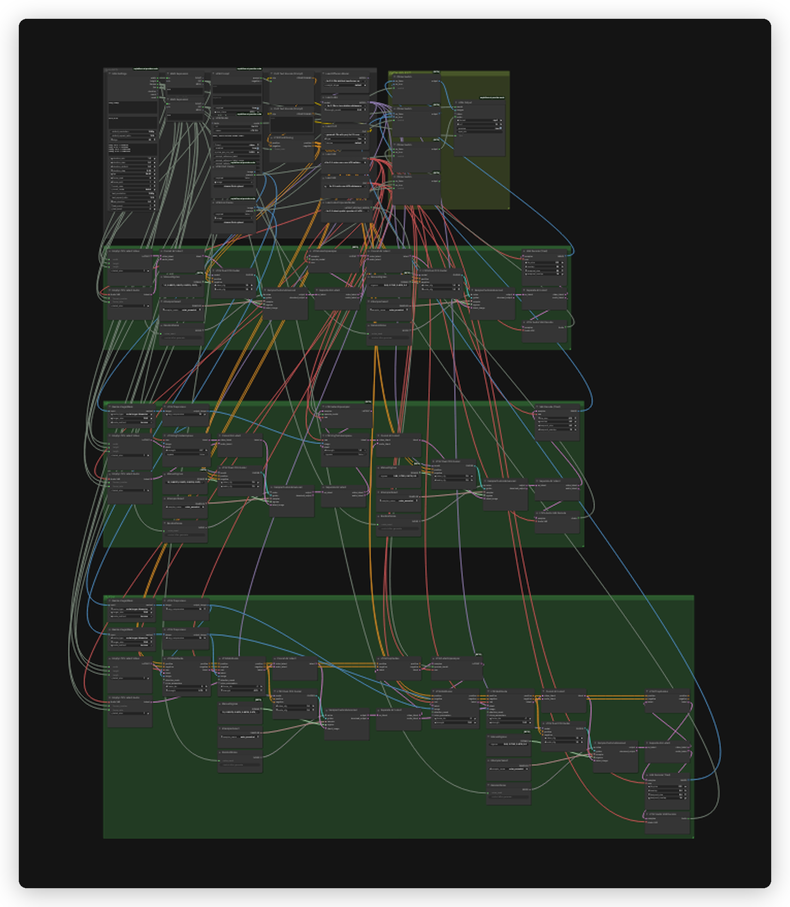

# LTX 2.5 UPAI flow

## What it does

One UPAI video model, id `ltx-2-5`, name `LTX 2.5`, kind `video`. One graph with three paths selected by the optional start and end frames: text-to-video, image-to-video and first-last-frame video. Audio is generated and muxed into the final MP4 by UPAI Output.

## Modes

| Start | End | Mode |
|---|---|---|
| no | any | text-to-video |
| yes | no | image-to-video |
| yes | yes | first-last-frame video |

`UPAI StartFrame.present` and `UPAI EndFrame.present` drive lazy core `ComfySwitchNode` switches in the `PATH SELECT` group. Only the selected branch runs. Both frame inputs are optional. `UPAI EndFrame` without `UPAI StartFrame` still runs text-to-video by design.

## Quick start

1. Install ComfyUI 0.43.0 or newer and the `unplatform-ai-provider-node` pack.
2. Open `ltx-2-5-upai.json` in ComfyUI.
3. ComfyUI reads the download and install links from the workflow. Open the right-side Error tab and click Install for missing packs and Download for missing models. No copy-paste from this readme.
4. This flow uses no GGUF. All model files are auto-downloaded from the workflow.
5. Restart ComfyUI after installing a pack. Save the workflow once so UPAI exports it.
6. Check `GET /upai/api/v1/health`.

The flow uses core ComfyUI 0.43.0 LTX nodes only. `ComfyUI-LTXVideo` is not required.

## Memory

Full speed means the largest phase fits in VRAM. Smaller cards run with offload to system RAM, slower. System RAM must hold the model files.

| Phase | Weights | Headroom | Total |
|---|---:|---:|---:|
| Text encode | 14.32 GiB | 0.50 GiB | 14.82 GiB |
| Sampling, 1080p, 121 frames | 20.96 GiB | 4.00 GiB | 24.96 GiB |
| Decode, VAEDecodeTiled | 1.69 GiB | 1.50 GiB | 3.19 GiB |

Full-speed VRAM: 32 GB card. System RAM: 48 GB.

| File | Size | Note |
|---|---:|---|
| `ltx-2.5-22b-distilled-transformer-comfy-int8-convrot.safetensors` | 20.03 GiB | estimate |
| `gemma4-12b-with-proj-ltx-2.5-comfy-int8-convrot.safetensors` | 14.32 GiB | estimate |
| `ltx-2.5-video-vae-conv-bf16.safetensors` | 1.35 GiB | estimate |
| `ltx-2.5-audio-vae-bf16.safetensors` | 0.34 GiB | estimate |
| `ltx-2.5-latent-spatial-upscaler-x2-bf16-1.0.safetensors` | 0.93 GiB | estimate |
| `ltx-2-19b-ic-lora-detailer.safetensors` | 2.44 GiB | estimate, not resident |

The upscaler runs in the sampling phase. The detailer LoRA patches the model and does not stay resident.

Low VRAM:

- In UPAI Settings, set `default_resolution` to `720p` (node id 1) and lower `duration_max`.
- On `VAEDecodeTiled` nodes 118, 222 and 328, set `tile_size` from 512 to 256 or 384, keep `overlap` 64, set `temporal_size` from 64 to 16 or 32, and keep `temporal_overlap` 8.
- The detailer LoRA does not add VRAM. Bypass it only to save time.
- Start ComfyUI with `--fast-disk` and `--cache-none`.
- If decode still runs out of memory, start ComfyUI with `--cpu-vae`. That moves `VAEDecodeTiled` and `LTXVAudioVAEDecode` to system RAM.

## Models

| File | Folder | Note |
|---|---|---|
| `ltx-2.5-22b-distilled-transformer-comfy-int8-convrot.safetensors` | `models/diffusion_models` | auto |
| `gemma4-12b-with-proj-ltx-2.5-comfy-int8-convrot.safetensors` | `models/text_encoders` | auto |
| `ltx-2.5-video-vae-conv-bf16.safetensors` | `models/vae` | auto |
| `ltx-2.5-audio-vae-bf16.safetensors` | `models/vae` | auto |
| `ltx-2.5-latent-spatial-upscaler-x2-bf16-1.0.safetensors` | `models/latent_upscale_models` | auto |
| `ltx-2-19b-ic-lora-detailer.safetensors` | `models/loras` | auto |

No GGUF file is used. The detailer LoRA is applied at strength 0.3.

Licenses:

- `ltx-2.5-22b-distilled-transformer-comfy-int8-convrot.safetensors`, `ltx-2.5-video-vae-conv-bf16.safetensors`, `ltx-2.5-audio-vae-bf16.safetensors`, `ltx-2.5-latent-spatial-upscaler-x2-bf16-1.0.safetensors`: License: LTX-2.x Community License Agreement. Source: https://huggingface.co/Lightricks/LTX-2.5
- `gemma4-12b-with-proj-ltx-2.5-comfy-int8-convrot.safetensors`: License: Apache-2.0. Source: https://huggingface.co/google/gemma-4-12B
- `ltx-2-19b-ic-lora-detailer.safetensors`: License: LTX-2 Community License. Source: https://huggingface.co/Lightricks/LTX-2-19b-IC-LoRA-Detailer

## Settings

| Control | Value |
|---|---|
| Sampling | two stages, 8 steps then 3 steps |
| CFG | 1 for video and audio |
| Sampler | `euler_ancestral` |
| Sigmas | manual lists |
| Stage 1 sigmas | `1.0, 0.99375, 0.9875, 0.98125, 0.975, 0.909375, 0.725, 0.421875, 0.0` |
| Stage 2 sigmas | `0.85, 0.7250, 0.4219, 0.0` |
| fps | 24 |
| Frames | 121 at 5 s (`5 * 24 + 1`) |
| Duration | 1 to 5 s in 0.25 steps |
| Frame modulus | 8, offset 1 |
| Prompt budget | UPAI Prompt caps at 4000 characters |
| Negative prompt | not linked |

Stage 1 runs at half the final size and a 2x latent upscale returns the exact final size. UPAI Settings defaults are `1080p`, `16:9`, duration `5` and count `1`.

Final sizes sit on the 32-pixel grid. Stage 1 runs at half.

- 720p 16:9: 1280x736
- 720p 9:16: 736x1280
- 1080p 16:9: 1920x1088
- 1080p 9:16: 1088x1920

## Troubleshooting

- Unknown node type: update ComfyUI to 0.43.0 and install the unplatform pack.
- Model not found: filenames must match the table exactly, including the `conv` video VAE name.
- Out of memory: use 720p and a shorter duration.
- Silent video: confirm the audio VAE is present and the audio decode is connected.
- Start frame ignored: confirm `UPAI StartFrame` has an image, the switch uses its `present` output.
- Negative prompt has no effect: it is not linked on purpose.
- Weak motion or drift: write a longer descriptive paragraph and keep the camera move explicit.
