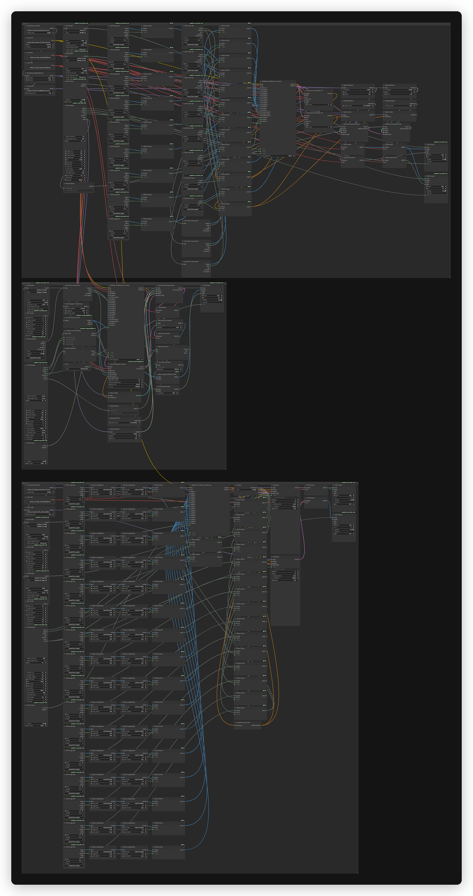

# MiniMax H3 UPAI flow



## What it does

One UPAI workflow for MiniMax H3 with video presets `minimax-h3` (MiniMax H3, 20 steps) and `minimax-h3-fast` (MiniMax H3 Fast, 8 steps). Input is a prompt, optional start and end frames, and up to 9 image refs, 3 video refs and 3 audio refs. Output is 24 fps MP4.

The same file adds image presets `minimax-h3-image` (6 steps) and `minimax-h3-image-fast` (2-step pDMD LoRA) for text-to-image and reference editing with up to 16 image refs.

## Modes

| Mode | Input | Output |
|---|---|---|
| Text-to-video | prompt | 24 fps MP4 |
| Image-to-video | prompt and start frame | 24 fps MP4 |
| First-last-frame video | prompt, start frame and end frame | 24 fps MP4 |
| Reference-to-video | prompt and up to 9 image, 3 video and 3 audio refs | 24 fps MP4 |

## Quick start

1. Install ComfyUI 0.45.0 or newer and the `unplatform-ai-provider-node` pack. The image presets need 0.45.0 for `MiniMaxH3ImageConditioning`. The video presets need 0.43.0, but the same file contains the image branch.
2. Open `minimax-h3-upai.json` in ComfyUI.
3. ComfyUI reads the download and install links from the workflow. Open the right-side Error tab and click Install for missing packs and Download for missing models. No copy-paste from this readme.
4. This flow uses no GGUF. All model files are auto-downloaded from the workflow.
5. Restart ComfyUI after installing a pack. Save the workflow once so UPAI exports it.
6. Check `GET /upai/api/v1/health`.

## Memory

Full speed means the largest phase fits in VRAM. Smaller cards run with offload to system RAM, slower. System RAM must hold the model files.

| Phase | Weights | Headroom | Total |
|---|---:|---:|---:|
| Text encode | 25.28 GiB | 0.50 GiB | 25.78 GiB |
| Sampling, 1280x736, 124 frames | 19.53 GiB | 4.00 GiB | 23.53 GiB |
| Decode, VAEDecode | 5.13 GiB | 3.00 GiB | 8.13 GiB |

Full-speed VRAM: 32 GB card. System RAM: 64 GB.

| File | Size | Note |
|---|---:|---|
| `qwen3vl_32b_minimax_h3_int8_convrot.safetensors` | 25.28 GiB | measured |
| `minimax_h3_ref2va_pruned_int8_convrot.safetensors` | 19.53 GiB | measured |
| `minimax_h3_video_vae_fp16.safetensors` | 4.85 GiB | measured |
| `minimax_h3_audio_vae_fp32.safetensors` | 0.56 GiB | measured, loads at 0.28 GiB |
| `minimax_h3_turbo_v4_step600_ema_pruned_comfyui.safetensors` | 0.58 GiB | estimate, not resident |

The audio VAE loads at 0.50x its fp32 file size. LoRAs patch the model and do not stay resident. The measured text encode phase is 25.78 GiB, under 29.6 GiB usable.

Low VRAM:

- Use the `minimax-h3-fast` preset.
- In UPAI Settings, set `default_resolution` to `0.4` or lower (node id 10), set `duration_min` and `duration_max` to 2 to 3 s, and set `count_max` to 1. The 17k+5 frame rule gives 56 frames at 2 s and 73 frames at 3 s.
- Start ComfyUI with `--fast-disk`.
- If decode runs out of memory, start ComfyUI with `--cpu-vae`. MiniMax uses `VAEDecode` nodes 61 and 67.

## Models

| File | Folder | Note |
|---|---|---|
| `qwen3vl_32b_minimax_h3_int8_convrot.safetensors` | `models/text_encoders` | auto |
| `minimax_h3_ref2va_pruned_int8_convrot.safetensors` | `models/diffusion_models` | auto |
| `minimax_h3_video_vae_fp16.safetensors` | `models/vae` | auto |
| `minimax_h3_audio_vae_fp32.safetensors` | `models/vae` | auto |
| `minimax_h3_turbo_v4_step600_ema_pruned_comfyui.safetensors` | `models/loras` | auto, optional |

No GGUF file is used. Only these five files are needed for the video presets. The image presets add three image files and an optional prompt helper.

Licenses:

- `qwen3vl_32b_minimax_h3_int8_convrot.safetensors`: Author: MiniMaxAI. Base model: Qwen3-VL-32B-Instruct by Qwen. License: MiniMax H3 Community License Agreement. Source: https://huggingface.co/MiniMaxAI/MiniMax-H3
- `minimax_h3_ref2va_pruned_int8_convrot.safetensors`, `minimax_h3_video_vae_fp16.safetensors`, `minimax_h3_audio_vae_fp32.safetensors`: License: MiniMax H3 Community License Agreement. Source: https://huggingface.co/MiniMaxAI/MiniMax-H3
- `minimax_h3_turbo_v4_step600_ema_pruned_comfyui.safetensors`: License: Apache-2.0. Source: https://huggingface.co/drbaph/MiniMax-H3-Turbo-Lora-ComfyUI

The audio ref is a text field. Put the audio file under `ComfyUI/input/` and type its name. The node patches the path at dispatch.

## Settings

| Preset | Steps | Sampler | Scheduler | Turbo LoRA |
|---|---|---|---|---|
| `minimax-h3` | 20 | `res_multistep` | `simple` | no |
| `minimax-h3-fast` | 8 | `euler` | `simple` | yes |

Frames follow 17k+5: 5, 22, 39, ..., 362. Duration runs 4 to 15 s. 5 s gives 124 frames, 10.125 s gives 243 and 15.08 s gives 362. fps is 24.

Sizes snap to a 32-pixel grid. Tiers run from 0.2 to 2.0 area and 6 aspect ratios (16:9, 21:9, 4:3, 1:1, 3:4, 9:16), with 84 exact size overrides. The default is 0.9 at 16:9, 1280x736. H3-Base official area cap is 0.98 MP, 1344x768 at 16:9. Labels 1.0 and above exceed the cap.

References allow 9 image refs, 3 video refs and 3 audio refs, max 12 files total. Video refs run 2 to 15 s at 24 fps. Audio refs run 2 to 15 s. Prompt max is 7000 characters. Start and end frames are optional.

## MiniMax H3 Extend

Preset `minimax-h3-extend` extends one source video. Video ref 1 is the source, the prompt is the only other input, and one run adds one extension.

- Input: video ref 1 and a prompt. Image, video and audio references are not used in extend.
- New video: max 15 s, default 5 s.
- Output: the source video followed by the new extension.
- Context: the last 3 s (39 frames) of the source seed the extension.
- Audio continues across the join.
- Best with a 24 fps source.
- Prompt: say the action continues from the final moment with no cut.

No new model files. The extend preset uses the same text encoder, diffusion model and VAEs.

Extend needs a custom node pack that is not in the ComfyUI Manager registry. Clone it:

```bash
cd ComfyUI/custom_nodes
git clone https://github.com/seitanism/ComfyUI-H3-Motion-Context-MultiRef
```

Restart ComfyUI after the clone. The pack provides `MiniMaxH3CropTo32`, `MiniMaxH3StartCanvasSelector` and `MiniMaxH3StartMaskedContext`.

Clone `seitanism/ComfyUI-H3-Motion-Context-MultiRef` because it is the `aux_id` stored in the workflow and its main branch has all three nodes. The workflow version field points at `ee38f3dd`, which is older and does not have the last two nodes, so use main. Do not clone `Aitrepreneur/ComfyUI-H3-Motion-Context-MultiRef-V3`. That repository is the fork used for validation, not the workflow source, and it trails the upstream fixes.

Memory estimate: the same files as the video presets. The peak is text encode at 25.78 GiB. Sampling is 23.53 GiB at 1280x736 and 124 frames. Both are estimates. Use a 32 GB card and 64 GB system RAM.

## MiniMax H3 Image

MiniMax H3 Image license excludes use in the US, EU, UK and South Korea. Check the license before use.

The license defines the Excluded Territories as: "'Excluded Territories' means the European Union, the United Kingdom, the Republic of Korea and the United States of America." Full text: https://huggingface.co/MiniMaxAI/MiniMax-H3-Image/blob/main/LICENSE

Preset `minimax-h3-image`. Text-to-image when no refs are set. With one or more refs it edits instead.

- ComfyUI 0.45.0 or newer.
- Input: a prompt and up to 16 image refs.
- Picture 1 is the edit canvas. Pictures 2 to 16 are references.
- No refs means text-to-image.
- Output: PNG at 4MP by default. 8MP and 16MP are options.
- Aspect ratios: 1:1, 4:3, 3:4, 3:2, 2:3, 16:9, 9:16, 21:9. Default is 4MP at 1:1.
- Sampler: 6 steps, CFG 1, euler, simple, denoise 1.
- No mask, depth or control input. Pose Studio is optional, not required.

Memory estimate: text encode 25.78 GiB with the shared 25.28 GiB encoder. Sampling is 21.54 GiB at 4MP. Decode is 1.09 GiB. Use a 32 GB card and 64 GB system RAM. The sampling headroom grows with the resolution, so 8MP and 16MP are heavier than the 4MP estimate.

Model files:

| File | Folder | Size | Note |
|---|---|---:|---|
| `minimax_h3_image_pruned_int8_convrot.safetensors` | `models/diffusion_models` | 19.54 GiB | auto |
| `minimax_h3_image_vae_fp16.safetensors` | `models/vae` | 1.09 GiB | auto |
| `qwen3vl_32b_minimax_h3_int8_convrot.safetensors` | `models/text_encoders` | 25.28 GiB | auto, shared with the video presets |
| `minimax_h3_pdmd_2nfe_comfyui.safetensors` | `models/loras` | 1.82 GiB | auto, fast preset |
| `qwen3.5_9b_w4a8_gptq.safetensors` | `models/text_encoders` | 6.84 GiB | optional prompt helper |

Links:

- Image UNET: https://huggingface.co/Comfy-Org/MiniMax-H3-Image/resolve/main/diffusion_models/minimax_h3_image_pruned_int8_convrot.safetensors
- Image VAE: https://huggingface.co/Comfy-Org/MiniMax-H3-Image/resolve/main/vae/minimax_h3_image_vae_fp16.safetensors
- Shared text encoder: https://huggingface.co/Comfy-Org/MiniMax-H3/resolve/main/text_encoders/qwen3vl_32b_minimax_h3_int8_convrot.safetensors
- pDMD LoRA: https://huggingface.co/akhaliq/minimax-h3-image-pdmd-2step/resolve/main/minimax_h3_pdmd_2nfe_comfyui.safetensors
- Optional Qwen3.5 9B prompt helper: https://huggingface.co/Comfy-Org/Qwen3.5/resolve/main/text_encoders/qwen3.5_9b_w4a8_gptq.safetensors

Credits:

- `minimax_h3_image_pruned_int8_convrot.safetensors`, `minimax_h3_image_vae_fp16.safetensors`: Author: MiniMaxAI. Repack: Comfy-Org. License: MiniMax H3 Image Community License Agreement. Source: https://huggingface.co/MiniMaxAI/MiniMax-H3-Image
- `qwen3vl_32b_minimax_h3_int8_convrot.safetensors`: Author: MiniMaxAI. The H3 encoder uses the full Qwen3-VL-32B weights, base model by Qwen. Repack: Comfy-Org. License: MiniMax H3 Community License Agreement. Source: https://huggingface.co/MiniMaxAI/MiniMax-H3
- `minimax_h3_pdmd_2nfe_comfyui.safetensors`: Original pDMD 2-NFE LoRA: pdmd2026/pdmd_2NFE_lora. ComfyUI conversion: Iwannapose/minimax_h3_pdmd_2nfe_comfyui. License: Apache-2.0. The workflow downloads the akhaliq mirror, which states it copies the Iwannapose conversion. Source: https://huggingface.co/pdmd2026/pdmd_2NFE_lora and https://huggingface.co/Iwannapose/minimax_h3_pdmd_2nfe_comfyui
- `qwen3.5_9b_w4a8_gptq.safetensors`: Author: Qwen. Repack: Comfy-Org. License: Apache-2.0. Source: https://huggingface.co/Qwen/Qwen3.5-9B

## MiniMax H3 Image Fast

Preset `minimax-h3-image-fast` uses the same image branch with the pDMD LoRA at strength 1.0.

- Steps: 2. Raise to 3 or 4 if quality drops.
- Otherwise the same inputs, references, sizes and output as `minimax-h3-image`.
- Memory: the same estimate as `minimax-h3-image`. The 1.82 GiB LoRA patches the model and does not stay resident.

## Troubleshooting

- UPAI nodes missing: install `unplatform-ai-provider-node` and restart ComfyUI.
- Loader red: the H3 model file is missing from the listed folder.
- Audio ref ignored: put the file in `ComfyUI/input/` and type the file name.
- Frames plus refs work together: up to 9 image, 3 video and 3 audio refs.
- Out of memory: use a lower area label such as 0.4 or 0.2, use the fast preset, and close other GPU apps. The fast preset lowers steps, not model size.
- Health check: `curl http://127.0.0.1:8188/upai/api/v1/health`.
