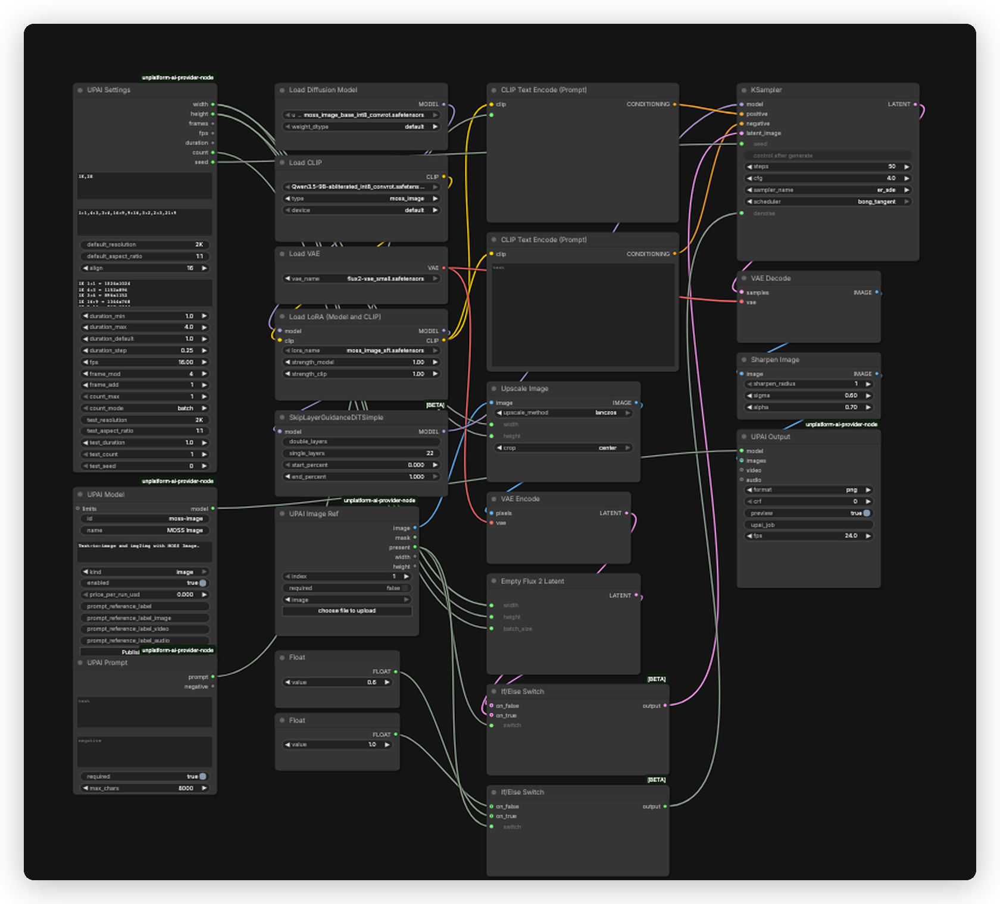

# MOSS Image UPAI flow

## What it does

Text-to-image and single-image img2img with MOSS Image base at 50 steps. Img2img scales the reference to the UPAI Settings size with a center crop, so the output follows the settings size in both modes.

## Modes

| Mode | Input | Output |
|---|---|---|
| Text-to-image | prompt | one image at the settings size |
| Img2img | prompt and one reference image | one image at the settings size |

## Quick start

1. Install ComfyUI 0.43.0 or newer and the `unplatform-ai-provider-node` pack.
2. Open `moss-image-upai.json` in ComfyUI.
3. ComfyUI reads the download and install links from the workflow. Open the right-side Error tab and click Install for missing packs and Download for missing models. No copy-paste from this readme.
4. This flow uses no GGUF. All model files are auto-downloaded from the workflow.
5. Restart ComfyUI after installing a pack. Save the workflow once so UPAI exports it.
6. Check `GET /upai/api/v1/health`.

## Memory

Full speed means the largest phase fits in VRAM. Smaller cards run with offload to system RAM, slower. System RAM must hold the model files.

| Phase | Weights | Headroom | Total |
|---|---:|---:|---:|
| Text encode | 8.82 GiB | 0.50 GiB | 9.32 GiB |
| Sampling, 2K | 5.04 GiB | 2.00 GiB | 7.04 GiB |
| Decode | 0.23 GiB | 0.00 GiB | 0.23 GiB |

Full-speed VRAM: 12 GB card. System RAM: 24 GB.

| File | Size | Note |
|---|---:|---|
| `moss_image_base_int8_convrot.safetensors` | 5.04 GiB | estimate |
| `Qwen3.5-9B-abliterated_int8_convrot.safetensors` | 8.82 GiB | estimate |
| `flux2-vae_small.safetensors` | 0.23 GiB | estimate |
| `moss_image_sft.safetensors` | 0.27 GiB | estimate, not resident |

The SFT LoRA patches the model and does not stay resident.

Low VRAM:

- In UPAI Settings, set `default_resolution` to `1K` (node id 3).
- 12 GB is full speed at 2K. Use 1K on smaller cards and one job at a time.

## Models

| File | Folder | Note |
|---|---|---|
| `moss_image_base_int8_convrot.safetensors` | `models/diffusion_models` | auto |
| `Qwen3.5-9B-abliterated_int8_convrot.safetensors` | `models/text_encoders` | auto |
| `flux2-vae_small.safetensors` | `models/vae` | auto |
| `moss_image_sft.safetensors` | `models/loras` | auto |

No GGUF file is used. The flow uses the SFT adapter at 1.0 and no turbo, DMD2, controlnet or depth.

Licenses:

- `moss_image_base_int8_convrot.safetensors`: License: Apache-2.0. Source: https://huggingface.co/OpenMOSS-Team/MOSS-Image-Base
- `Qwen3.5-9B-abliterated_int8_convrot.safetensors`: License: Apache-2.0. Abliteration: https://huggingface.co/wangzhang/Qwen3.5-9B-abliterated. INT8 conversion: https://huggingface.co/beycanai/Qwen-LM. Base model: https://huggingface.co/Qwen/Qwen3.5-9B.
- `flux2-vae_small.safetensors`: License: Apache-2.0. Source: https://huggingface.co/Comfy-Org/MOSS-Image
- `moss_image_sft.safetensors`: License: Apache-2.0. Source: https://huggingface.co/OpenMOSS-Team/MOSS-Image-SFT

## Settings

| Control | Value |
|---|---|
| Steps | 50 |
| CFG | 4.0 |
| Sampler | `er_sde` |
| Scheduler | `bong_tangent` |
| Skip Layer Guidance | single layer 22, start 0, end 1 |
| Denoise | 1.0 text-to-image, 0.6 img2img |
| SFT LoRA | 1.0 model and 1.0 clip |
| ImageSharpen | radius 1, sigma 0.6, alpha 0.7 |
| Pixel grid | 16 |
| Prompt budget | 4096 tokens, UPAI Prompt caps at 8000 characters |

The base loads through `UNETLoader`, the text encoder through `CLIPLoader` with type `moss_image`, then the SFT adapter through the core `LoraLoader`. Denoise follows the optional reference.

Sizes run at 1K and 2K across 8 aspect ratios (1:1, 4:3, 3:4, 16:9, 9:16, 3:2, 2:3, 21:9). All sizes are multiples of 16. The maximum side is 2048. The app shows exact pixels. Img2img uses the same size, so the reference is cropped to fit.

## Troubleshooting

- UPAI nodes missing: install `unplatform-ai-provider-node` and restart ComfyUI.
- Loader red: the model file is in the wrong folder or missing.
- Text encode error: set the `CLIPLoader` type to `moss_image`.
- Blank or weak output: confirm `moss_image_sft.safetensors` is in `models/loras` and loaded at 1.0.
- `ImageSharpen` missing: update ComfyUI to 0.43.0 or newer.
- Out of memory: use 1K and reduce other GPU memory use.
- Health check: `curl http://127.0.0.1:8188/upai/api/v1/health`.
