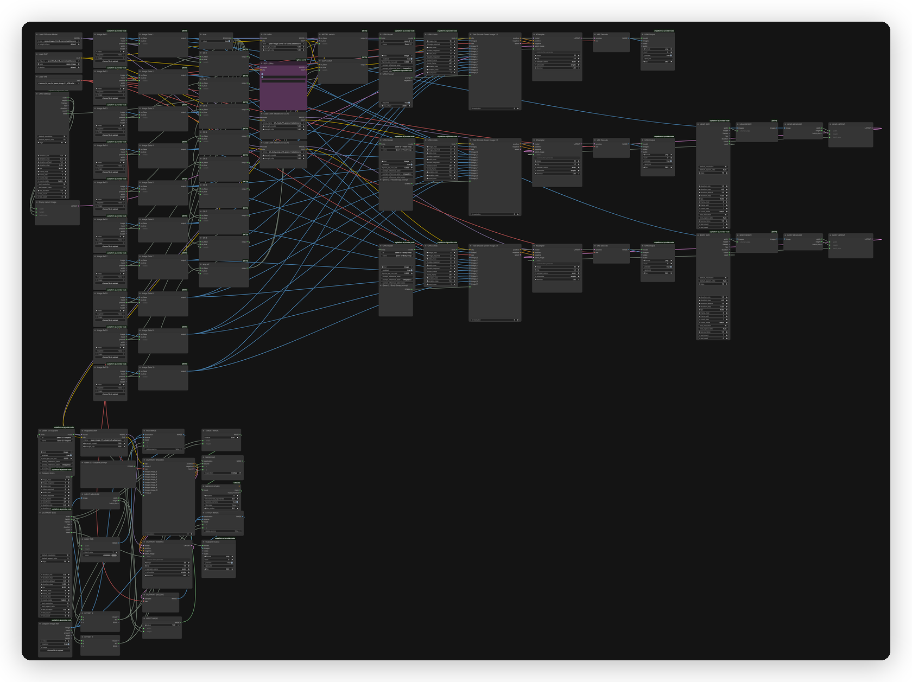

# Qwen 2.1 UPAI flow

## What it does

One UPAI image workflow for Qwen Image 2.1. It ships four model ids, `qwen-2-1`, `qwen-2-1-head-swap`, `qwen-2-1-body-swap` and `qwen-2-1-outpaint`, all at 25 steps. The base model takes text or up to 10 reference images. The two swap models each take exactly 2 references. The outpaint model takes exactly 1 reference and no prompt.

## Modes

| Model id | Mode | LoRA | Refs | Prompt |
|---|---|---|---|---|
| `qwen-2-1` | text or refs | fix LoRA with no refs, `REF LORAs` list with refs | 0 to 10 | dynamic |
| `qwen-2-1-head-swap` | head swap | `bfs_head_v1.1_qwen_2.1` | exactly 2 | static |
| `qwen-2-1-body-swap` | body swap | `bfs_body_swap_v1.0_qwen_2.1` | exactly 2 | static |
| `qwen-2-1-outpaint` | outpaint | `qwen-image-2.1-outpaint-v2` | exactly 1 | baked |

`qwen-2-1` watches the ten reference gates. Any reference present switches model and CLIP to the `REF LORAs` list, otherwise the fix LoRA. The swap models ignore the UPAI Prompt. Head swap uses image 1 as the base scene and image 2 for the head and face. Body swap uses image 1 as the base scene and image 2 for the body, clothing, shape and proportions.

`qwen-2-1-head-swap` and `qwen-2-1-body-swap` use `Auto` aspect. The selected resolution sets the shorter edge, and the output aspect follows image 1.

## Qwen 2.1 Outpaint

`qwen-2-1-outpaint` extends one image to the selected resolution and aspect. It takes exactly 1 reference and no prompt. The prompt is baked in: "Outpaint the image: replace the solid gray areas with a seamless continuation of the scene, keeping the existing picture unchanged."

- Resolution and aspect use the same lists as the base model: 512, 768, 1K, 1.5K, 2K and 4K across 1:1, 4:3, 3:4, 16:9, 9:16, 3:2 and 2:3.
- The selected resolution is the output resolution. Qwen samples at that latent size.
- The input image is centered on the target canvas.
- Pick a resolution larger than the input to outpaint. A smaller resolution crops the input.
- The new area is padded with gray `#808080`.
- The outpaint LoRA is `qwen-image-2.1-outpaint-v2.safetensors`, 152 MiB.
- The original picture is stitched back with an 8 px feathered mask.
- Sampling is 25 steps, CFG 1, `euler`, `simple`.

Memory estimate: the same files as `qwen-2-1` plus the outpaint LoRA. The peak is text encode at 9.21 GiB. Sampling is 8.76 GiB at 1K. Use a 12 GB card and 24 GB system RAM. 2K and 4K need more sampling memory.

## Quick start

1. Install ComfyUI 0.43.0 or newer and the `unplatform-ai-provider-node` pack.
2. Open `qwen-2-1-upai.json` in ComfyUI.
3. ComfyUI reads the download and install links from the workflow. Open the right-side Error tab and click Install for missing packs and Download for missing models. No copy-paste from this readme.
4. This flow uses no GGUF. All model files are auto-downloaded from the workflow.
5. Restart ComfyUI after installing a pack. Save the workflow once so UPAI exports it.
6. Check `GET /upai/api/v1/health`.

## Memory

Full speed means the largest phase fits in VRAM. Smaller cards run with offload to system RAM, slower. System RAM must hold the model files.

| Phase | Weights | Headroom | Total |
|---|---:|---:|---:|
| Text encode | 8.71 GiB | 0.50 GiB | 9.21 GiB |
| Sampling, 1K | 6.76 GiB | 2.00 GiB | 8.76 GiB |
| Decode | 0.63 GiB | 0.00 GiB | 0.63 GiB |

Full-speed VRAM: 12 GB card. System RAM: 24 GB.

| File | Size | Note |
|---|---:|---|
| `qwen_image_2.1_int8_convrot.safetensors` | 6.76 GiB | measured |
| `qwen3vl_8b_int8_convrot.safetensors` | 8.71 GiB | measured |
| `texture_fix_vae_for_qwen_image_2.1_bf16.safetensors` | 0.63 GiB | measured |
| `qwen-image-2.1-fix-1.0-comfy.safetensors` | 0.10 GiB | estimate, not resident |
| `lenovo_qwen21.safetensors` | 0.07 GiB | estimate, not resident |
| `bfs_head_v1.1_qwen_2.1.safetensors` | 0.24 GiB | estimate, not resident |
| `bfs_body_swap_v1.0_qwen_2.1.safetensors` | 0.20 GiB | estimate, not resident |

LoRAs patch the model and do not stay resident. The measured main model with LoRAs matched the main file size.

Low VRAM:

- In UPAI Settings, set `resolutions` to `1K` (main node id 21, swap nodes 63 and 67).
- Set `count_max` to 1.
- Start ComfyUI with `--cache-none`.

## Models

| File | Folder | Note |
|---|---|---|
| `qwen3vl_8b_int8_convrot.safetensors` | `models/text_encoders` | auto |
| `texture_fix_vae_for_qwen_image_2.1_bf16.safetensors` | `models/vae` | auto |
| `qwen_image_2.1_int8_convrot.safetensors` | `models/diffusion_models` | auto |
| `qwen-image-2.1-fix-1.0-comfy.safetensors` | `models/loras` | auto |
| `lenovo_qwen21.safetensors` | `models/loras` | auto |
| `bfs_head_v1.1_qwen_2.1.safetensors` | `models/loras` | auto |
| `bfs_body_swap_v1.0_qwen_2.1.safetensors` | `models/loras` | auto |
| `qwen-image-2.1-outpaint-v2.safetensors` | `models/loras` | auto, 152 MiB |

No GGUF file is used. There is no fp8 or lite variant.

Licenses:

- `qwen3vl_8b_int8_convrot.safetensors`: License: Apache-2.0. Source: https://huggingface.co/Qwen/Qwen3-VL-8B-Instruct
- `texture_fix_vae_for_qwen_image_2.1_bf16.safetensors`: License: Qwen Research License. Source: https://huggingface.co/madebyollin/texture-fix-vae-for-qwen-image-2.1
- `qwen_image_2.1_int8_convrot.safetensors`: License: Qwen Research License. Source: https://huggingface.co/Qwen/Qwen-Image-2.1
- `qwen-image-2.1-fix-1.0-comfy.safetensors`: License: not stated on the model card. Source: https://huggingface.co/e-n-v-y/Qwen-Image-2.1-Fix
- `lenovo_qwen21.safetensors`: License: Apache-2.0. Source: https://huggingface.co/Danrisi/Lenovo_Qwen
- `bfs_head_v1.1_qwen_2.1.safetensors`: License: MIT. Source: https://huggingface.co/Alissonerdx/BFS-Best-Face-Swap
- `bfs_body_swap_v1.0_qwen_2.1.safetensors`: License: MIT. Source: https://huggingface.co/Alissonerdx/BFS-Best-Face-Swap
- `qwen-image-2.1-outpaint-v2.safetensors`: Author: ausboss. License: Qwen Research License. Source: https://huggingface.co/ausboss/Qwen-Image-2.1-Outpaint-LoRA

The refs path uses the `Power Lora Loader (rgthree)` node titled `REF LORAs`, so install `rgthree-comfy`, Manager id `rgthree-comfy`. The fix, outpaint and both swap paths use the core `LoraLoader`.

## Settings

| Control | Value |
|---|---|
| Steps | 25 |
| Sampler | `euler` |
| Scheduler | `simple` |
| CFG | 1 |
| Denoise | 1 |
| Default size | 1K, 1:1 |
| Prompt budget | UPAI Prompt caps at 2000 characters |
| Negative prompt | none |

Sizes run at 512 and 768 for low VRAM, then 1K, 1.5K and 2K. 1.5K is a generic area tier, not an official Qwen tier. The default is 1K 1:1. The official Qwen Image 2.1 tier is 2K across 7 aspect ratios (1:1, 4:3, 3:4, 3:2, 2:3, 16:9, 9:16), max side 2752.

4K is experimental at 2x the 2K dimensions. It is not official, heavier on VRAM and can reduce prompt adherence. Use 2K when 4K fails. Output size follows the selected resolution and aspect ratio. References and swap images condition the model but do not change the canvas size.

## Troubleshooting

- UPAI nodes missing: install `unplatform-ai-provider-node` and restart ComfyUI.
- `REF LORAs` node missing: install `rgthree-comfy` and restart.
- Loader red: the model file is in the wrong folder or missing.
- Fix LoRA row red: `qwen-image-2.1-fix-1.0-comfy` is missing, it is used with no refs.
- `REF LORAs` row red: `lenovo_qwen21` is missing, it is used with refs.
- UPAI Prompt missing on a swap model: expected, it uses a static prompt.
- 4K slow or fails: use 2K and close other GPU apps.
- Health check: `curl http://127.0.0.1:8188/upai/api/v1/health`.
