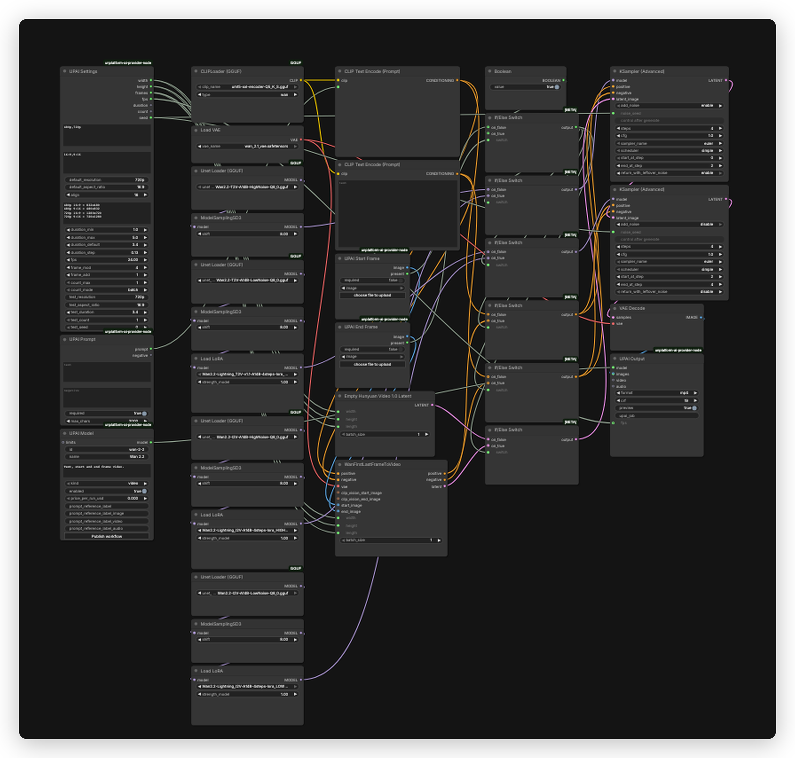

# Wan 2.2 UPAI flow

## What it does

One UPAI video workflow, `wan-2-2-upai.json`, with one model, `wan-2-2`. Three modes: text-to-video, image-to-video and first-last-frame video. Output is MP4 at the UPAI Settings size and fps.

## Modes

| Mode | Input | Model pair |
|---|---|---|
| Text-to-video | prompt | T2V high and low |
| Image-to-video | prompt and start frame | I2V high and low |
| First-last-frame video | prompt, start frame and optional end frame | I2V high and low |

The frames path runs when a start or end frame is present. Start frame is required for the frames path, end frame is optional. With no frame the T2V path uses `EmptyHunyuanLatentVideo`. With a frame the I2V path uses `WanFirstLastFrameToVideo`. There is no reference-image mode.

## Quick start

1. Install ComfyUI 0.43.0 or newer and the `unplatform-ai-provider-node` pack.
2. Open `wan-2-2-upai.json` in ComfyUI.
3. ComfyUI reads the download and install links from the workflow. Open the right-side Error tab and click Install for missing packs and Download for missing models. No copy-paste from this readme.
4. GGUF is the default here and is manual. ComfyUI detects the file but does not offer Download. Use the chain icon next to the missing file or the URLs below.
5. Restart ComfyUI after installing a pack. Save the workflow once so UPAI exports it.
6. Check `GET /upai/api/v1/health`.

## Memory

Full speed means the largest phase fits in VRAM. Smaller cards run with offload to system RAM, slower. System RAM must hold the model files.

| Phase | Weights | Headroom | Total |
|---|---:|---:|---:|
| Text encode | 3.77 GiB | 0.50 GiB | 4.27 GiB |
| Sampling, 720p, 81 frames | 14.35 GiB | 4.00 GiB | 18.35 GiB |
| Decode, VAEDecode | 0.24 GiB | 3.00 GiB | 3.24 GiB |

Full-speed VRAM: 24 GB card. System RAM: 48 GB.

| File | Size | Note |
|---|---:|---|
| `Wan2.2-T2V-A14B-HighNoise-Q8_0.gguf` | 14.35 GiB | estimate |
| `Wan2.2-T2V-A14B-LowNoise-Q8_0.gguf` | 14.35 GiB | estimate |
| `Wan2.2-I2V-A14B-HighNoise-Q8_0.gguf` | 14.35 GiB | estimate |
| `Wan2.2-I2V-A14B-LowNoise-Q8_0.gguf` | 14.35 GiB | estimate |
| `umt5-xxl-encoder-Q5_K_S.gguf` | 3.77 GiB | estimate |
| `wan_2.1_vae.safetensors` | 0.24 GiB | estimate |
| `Wan2.2-Lightning_T2V-v1.1-A14B-4steps-lora_LOW_fp16.safetensors` | 0.57 GiB | estimate, not resident |
| `Wan2.2-Lightning_I2V-A14B-4steps-lora_HIGH_fp16.safetensors` | 0.57 GiB | estimate, not resident |
| `Wan2.2-Lightning_I2V-A14B-4steps-lora_LOW_fp16.safetensors` | 0.57 GiB | estimate, not resident |

The high and low UNETs run one after the other. LoRAs patch the model and do not stay resident.

Smaller files:

| Quant | File | Sampling total | Full-speed card |
|---|---:|---:|---:|
| Q8 | 14.35 GiB | 18.35 GiB | 24 GB |
| Q6 | 11.18 GiB | 15.18 GiB | 24 GB |
| Q5 | 9.44 GiB | 13.44 GiB | 16 GB |
| Q4 | 8.15 GiB | 12.15 GiB | 16 GB |

The flow already uses GGUF through `UnetLoaderGGUF`. Set `unet_name` on the four UNET nodes. Lower quantizations cost some quality. Q5_K_S is the usual tradeoff.

Low VRAM:

- Set `UnetLoaderGGUF` `unet_name` to the Q5 or Q4 file on the four UNET nodes.
- In UPAI Settings, set `default_resolution` to `480p` (node id 1) and `duration_max` to 3.375 s or lower. That gives 49 to 81 frames.
- If decode runs out of memory, start ComfyUI with `--cpu-vae`. Wan uses `VAEDecode` node 18.

## Models

| File | Folder | Note |
|---|---|---|
| `Wan2.2-T2V-A14B-HighNoise-Q8_0.gguf` | `models/unet` | manual GGUF, T2V high |
| `Wan2.2-T2V-A14B-LowNoise-Q8_0.gguf` | `models/unet` | manual GGUF, T2V low |
| `Wan2.2-I2V-A14B-HighNoise-Q8_0.gguf` | `models/unet` | manual GGUF, frames high |
| `Wan2.2-I2V-A14B-LowNoise-Q8_0.gguf` | `models/unet` | manual GGUF, frames low |
| `umt5-xxl-encoder-Q5_K_S.gguf` | `models/text_encoders` | manual GGUF |
| `Wan2.1_VAE.safetensors` | `models/vae` | auto |
| `Wan2.2-Lightning_T2V-v1.1-A14B-4steps-lora_LOW_fp16.safetensors` | `models/loras` | auto |
| `Wan2.2-Lightning_I2V-A14B-4steps-lora_HIGH_fp16.safetensors` | `models/loras` | auto |
| `Wan2.2-Lightning_I2V-A14B-4steps-lora_LOW_fp16.safetensors` | `models/loras` | auto |

Manual GGUF URLs:

- `Wan2.2-T2V-A14B-HighNoise-Q8_0.gguf`: https://huggingface.co/QuantStack/Wan2.2-T2V-A14B-GGUF/resolve/main/HighNoise/Wan2.2-T2V-A14B-HighNoise-Q8_0.gguf
- `Wan2.2-T2V-A14B-LowNoise-Q8_0.gguf`: https://huggingface.co/QuantStack/Wan2.2-T2V-A14B-GGUF/resolve/main/LowNoise/Wan2.2-T2V-A14B-LowNoise-Q8_0.gguf
- `Wan2.2-I2V-A14B-HighNoise-Q8_0.gguf`: https://huggingface.co/QuantStack/Wan2.2-I2V-A14B-GGUF/resolve/main/HighNoise/Wan2.2-I2V-A14B-HighNoise-Q8_0.gguf
- `Wan2.2-I2V-A14B-LowNoise-Q8_0.gguf`: https://huggingface.co/QuantStack/Wan2.2-I2V-A14B-GGUF/resolve/main/LowNoise/Wan2.2-I2V-A14B-LowNoise-Q8_0.gguf
- `umt5-xxl-encoder-Q5_K_S.gguf`: https://huggingface.co/city96/umt5-xxl-encoder-gguf/resolve/main/umt5-xxl-encoder-Q5_K_S.gguf

Licenses:

- `Wan2.2-T2V-A14B-HighNoise-Q8_0.gguf`, `Wan2.2-T2V-A14B-LowNoise-Q8_0.gguf`: License: Apache-2.0. Source: https://huggingface.co/Wan-AI/Wan2.2-T2V-A14B
- `Wan2.2-I2V-A14B-HighNoise-Q8_0.gguf`, `Wan2.2-I2V-A14B-LowNoise-Q8_0.gguf`: License: Apache-2.0. Source: https://huggingface.co/Wan-AI/Wan2.2-I2V-A14B
- `umt5-xxl-encoder-Q5_K_S.gguf`: License: Apache-2.0. Source: https://huggingface.co/google/umt5-xxl
- `Wan2.1_VAE.safetensors`: License: Apache-2.0. Source: https://huggingface.co/Comfy-Org/Wan-2.1
- `Wan2.2-Lightning_T2V-v1.1-A14B-4steps-lora_LOW_fp16.safetensors`, `Wan2.2-Lightning_I2V-A14B-4steps-lora_HIGH_fp16.safetensors`, `Wan2.2-Lightning_I2V-A14B-4steps-lora_LOW_fp16.safetensors`: License: Apache-2.0. Source: https://huggingface.co/lightx2v/Wan2.2-Lightning

Q8_0 is the quality default. For lower VRAM, the same UNET filenames exist as `Q5_K_S` and `Q4_K_S`, both under 24 GB cards, from the same base URL. One swap per file is enough, the workflow reads the names from the loaders.

## Settings

| Control | Value |
|---|---|
| Steps | 4 |
| CFG | 1.0 |
| Sampler | `euler` |
| Scheduler | `simple` |
| Model sampling | `ModelSamplingSD3`, shift 8 |
| High-noise range | steps 0 to 2, add noise, keep leftover noise |
| Low-noise range | steps 2 to 4, no added noise |
| fps | 24 |
| Frames | 81 at 3.375 s |
| Resolutions | 480p and 720p |
| Aspect ratios | 16:9 and 9:16 |
| Prompt budget | 2000 characters, required |
| Negative | not linked |

The high sampler hands leftover noise to the low sampler, which returns a clean latent. The T2V branch applies the Lightning low LoRA on the low model. The frames branch applies the high LoRA on the high model and the low LoRA on the low model. All at 1.0.

Sizes run at 480p and 720p, at 16:9 (832x480, 1280x720) and 9:16 (480x832, 720x1280). The default is 720p 16:9. Duration runs 1 to 5 s in 0.125 s steps. Frame count is `duration * 24`, aligned to 4 with a 1 frame offset. The default 3.375 s gives 81 frames.

## Troubleshooting

- UPAI nodes missing: install `unplatform-ai-provider-node` and restart ComfyUI.
- Loader red: the GGUF file is in the wrong folder or missing. T2V and I2V files both go in `models/unet`.
- Text encode error: set the `CLIPLoaderGGUF` type to `wan`.
- Frames path not used: upload a start frame, it is required.
- Weak motion or noise: confirm the matching Lightning LoRA is present at 1.0.
- Out of memory: switch to Q5_K_S or Q4_K_S, use 480p, or close other GPU apps.
- Health check: `curl http://127.0.0.1:8188/upai/api/v1/health`.
