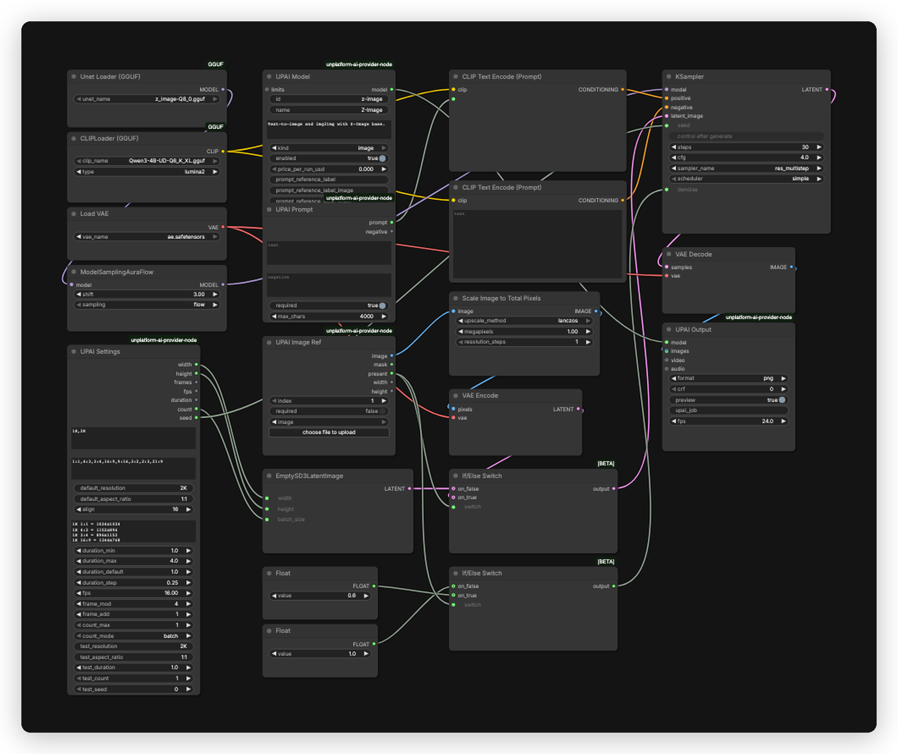

# Z-Image UPAI flow

## What it does

Text-to-image and single-image img2img with Z-Image base at 30 steps. Text-to-image uses the UPAI Settings size. Img2img scales the reference to 1 megapixel and keeps its aspect ratio, so the output follows the reference size.

## Modes

| Mode | Input | Output |
|---|---|---|
| Text-to-image | prompt | one image at the settings size |
| Img2img | prompt and one reference image | one image near 1 megapixel, at the reference aspect ratio |

## Quick start

1. Install ComfyUI 0.43.0 or newer and the `unplatform-ai-provider-node` pack.
2. Open `z-image-upai.json` in ComfyUI.
3. ComfyUI reads the download and install links from the workflow. Open the right-side Error tab and click Install for missing packs and Download for missing models. No copy-paste from this readme.
4. GGUF is the default here and is manual. ComfyUI detects the file but does not offer Download. Use the chain icon next to the missing file or the URLs below.
5. Restart ComfyUI after installing a pack. Save the workflow once so UPAI exports it.
6. Check `GET /upai/api/v1/health`.

## Memory

Full speed means the largest phase fits in VRAM. Smaller cards run with offload to system RAM, slower. System RAM must hold the model files.

| Phase | Weights | Headroom | Total |
|---|---:|---:|---:|
| Text encode | 3.41 GiB | 0.50 GiB | 3.91 GiB |
| Sampling, 2K | 6.73 GiB | 2.00 GiB | 8.73 GiB |
| Decode | 0.31 GiB | 0.00 GiB | 0.31 GiB |

Full-speed VRAM: 12 GB card. System RAM: 16 GB.

| File | Size | Note |
|---|---:|---|
| `z_image-Q8_0.gguf` | 6.73 GiB | estimate |
| `Qwen3-4B-UD-Q6_K_XL.gguf` | 3.41 GiB | estimate |
| `ae.safetensors` | 0.31 GiB | estimate |

Smaller files:

| Quant | File | Sampling total | Full-speed card |
|---|---:|---:|---:|
| Q8 | 6.73 GiB | 8.73 GiB | 12 GB |
| Q6 | 5.68 GiB | 7.68 GiB | 12 GB |
| Q5 | 4.93 GiB | 6.93 GiB | 12 GB |
| Q4 | 4.46 GiB | 6.46 GiB | 12 GB |

The flow already uses GGUF through `UnetLoaderGGUF`. Lower quantizations cost some quality. Q5_K_S is the usual tradeoff.

Low VRAM:

- Set `UnetLoaderGGUF` `unet_name` to `z_image-Q4_K_S.gguf`.
- In UPAI Settings, set `default_resolution` to `1K` (node id 3).

## Models

| File | Folder | Note |
|---|---|---|
| `z-image-Q8_0.gguf` | `models/unet` | manual GGUF, default |
| `z_image-Q6_K.gguf` | `models/unet` | manual GGUF, optional |
| `z_image-Q5_K_S.gguf` | `models/unet` | manual GGUF, optional |
| `Qwen3-4B-UD-Q6_K_XL.gguf` | `models/text_encoders` | manual GGUF |
| `ae.safetensors` | `models/vae` | auto |

Manual GGUF URLs:

- `z-image-Q8_0.gguf`: https://huggingface.co/unsloth/Z-Image-GGUF/resolve/main/z-image-Q8_0.gguf
- `z_image-Q6_K.gguf`: https://huggingface.co/unsloth/Z-Image-GGUF/resolve/main/z-image-Q6_K.gguf
- `z_image-Q5_K_S.gguf`: https://huggingface.co/unsloth/Z-Image-GGUF/resolve/main/z-image-Q5_K_S.gguf
- `Qwen3-4B-UD-Q6_K_XL.gguf`: https://huggingface.co/unsloth/Qwen3-4B-GGUF/resolve/main/Qwen3-4B-UD-Q6_K_XL.gguf

Licenses:

- `z-image-Q8_0.gguf`, `z_image-Q6_K.gguf`, `z_image-Q5_K_S.gguf`: License: Apache-2.0. Source: https://huggingface.co/Tongyi-MAI/Z-Image
- `Qwen3-4B-UD-Q6_K_XL.gguf`: License: Apache-2.0. Source: https://huggingface.co/Qwen/Qwen3-4B
- `ae.safetensors`: License: Apache-2.0. Source: https://huggingface.co/Comfy-Org/Z-Image

The default flow uses `z-image-Q8_0.gguf`. Replace the file name in `UnetLoaderGGUF` to use Q6_K or Q5_K_S. Lower quantizations need less VRAM.

## Settings

| Control | Value |
|---|---|
| Steps | 30 |
| CFG | 4.0 |
| Sampler | `res_multistep` |
| Scheduler | `simple` |
| Model sampling | `ModelSamplingAuraFlow`, shift 3 |
| Denoise | 1.0 text-to-image, 0.6 img2img |
| Pixel grid | 16 |
| Prompt budget | 512 tokens, UPAI Prompt caps at 4000 characters |
| Negative prompt | not linked |

`ModelSamplingAuraFlow` shift 3 applies before sampling. Denoise is 1.0 with no reference and 0.6 when a reference is present.

Sizes run at 1K and 2K across 8 aspect ratios (1:1, 4:3, 3:4, 16:9, 9:16, 3:2, 2:3, 21:9). All sizes are multiples of 16. The maximum side is 2048. The app shows exact pixels. Img2img follows the reference size, text-to-image uses the UPAI Settings size.

## Troubleshooting

- UPAI nodes missing: install `unplatform-ai-provider-node` and restart ComfyUI.
- GGUF loaders missing: install `ComfyUI-GGUF` and restart.
- Loader red: the model file is in the wrong folder or missing.
- Out of memory: use 1K or a smaller GGUF quantization.
- Health check: `curl http://127.0.0.1:8188/upai/api/v1/health`.
